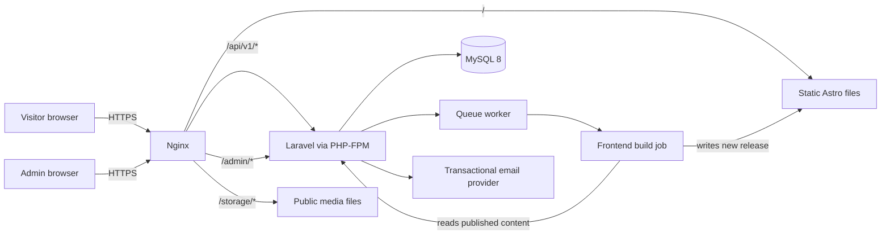
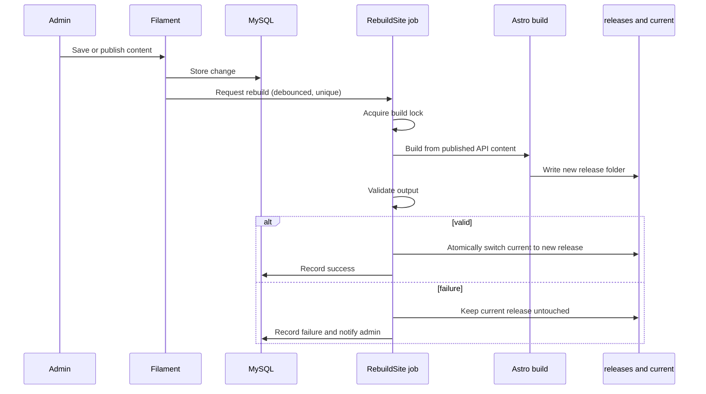

# Architecture

Status: **Draft for approval** (Stage 2).

## 1. Principles

- Decoupled frontend and backend in **one repository**.
- Backend is a **modular monolith**. No microservices.
- Static-first public site. No server-side rendering unless a documented requirement exists.
- Same-origin deployment (one domain) to keep CORS and cookies simple.
- Fewer moving parts is better. Every dependency must be justified.

## 2. System context



## 3. Repository layout

```
portfolio-platform/
├── backend/    Laravel 13 app (Filament 5 admin, API, jobs)
├── frontend/   Astro static site
├── deploy/     Nginx, Supervisor, scripts
├── docs/       Documentation and ADRs
├── .github/    CI workflows
├── README.md
├── CLAUDE.md
└── docker-compose.yml   (added in Stage 4: MySQL, Mailpit, optional Nginx and PHP-FPM)
```

## 4. Technology stack and verification status

| Component | Choice | Status |
|---|---|---|
| Backend framework | Laravel 13 (requires PHP 8.3 or newer) | Verified current major release |
| PHP | 8.4 provisionally | Verify package compatibility in Stage 4 |
| Admin | Filament 5 (Livewire 4 based) | Verified released; verify each plugin |
| Database | MySQL 8 | Decided |
| Frontend | Astro (latest stable at start of Stage 6), TypeScript | Version to be pinned in Stage 6 |
| Styling | Modern CSS in the public site; Tailwind 4.1+ only where Filament themes need it | Decided |
| Media | Spatie Media Library (see ADR-0003) | Proposed, verify with Filament 5 |
| Tests | Pest, Laravel Pint, frontend lint | Decided |
| API docs | OpenAPI-compatible generator (Scramble candidate) | Verify with Laravel 13 |
| Web server | Nginx + PHP-FPM | Decided |
| Queue | Database driver first (no Redis until needed) | Decided |
| Email | Transactional provider, undecided (ADR-0007) | Pending verification |

## 5. Responsibilities

| Layer | Owns |
|---|---|
| Astro frontend | Rendering public pages at build time, accessible UI, client-side filtering of the small project list, contact form submission to the API |
| Laravel API | Validation, serialization, published-only content, contact intake, rate limiting |
| Filament admin | All content editing, media, enquiries, settings, SEO fields, publishing controls |
| MySQL | Source of truth for all content |
| Queue worker | Email, frontend rebuilds |

## 6. Read flow (public visitor)

1. Visitor requests a page. Nginx serves pre-built HTML from `current/` (no PHP involved).
2. Only the contact form calls the API at runtime.

## 7. Write and publish flow



Details, limits and rollback are in [ADR-0002](adr/0002-publishing-pipeline.md).

## 8. Draft preview

Previews never use the public API. A signed, short-lived token created in Filament lets a dedicated preview route render a single draft with the same Astro components. See ADR-0002.

## 9. Media

Originals are managed by Laravel (Spatie Media Library) and exposed with metadata. Astro downloads originals during the build and creates all responsive variants, so only one system processes public images. See ADR-0003.

## 10. Environments

| Environment | Purpose | Status |
|---|---|---|
| Local | Development and tests (Docker for MySQL and Mailpit) | Planned Stage 4 |
| Local production-like | Nginx + PHP-FPM + MySQL in Docker to rehearse deployment for free | Planned Stage 4 |
| Staging | Real server, real HTTPS, test data | **Paused (cost)** |
| Production | Public site | **Paused (cost)** |

## 11. Error handling and observability

- Production never shows stack traces. Errors are logged without personal data.
- Build results are recorded in `site_builds` and shown on the admin dashboard.
- Server monitoring, uptime checks and error tracking are specified in DEPLOYMENT and enabled when a server exists.

## 12. Future Overcend compatibility

Brand text lives in settings, not code. The design system and suitable backend modules can later power a **separate** company site. No multi-tenancy is built now.
