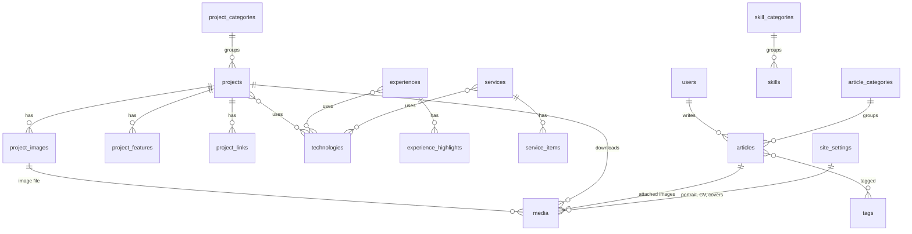

# Database Design

Status: **Draft for approval** (Stage 2). MySQL 8, InnoDB, `utf8mb4`.

Implementation note: columns described as enums (status, type, enquiry fields) are stored as short `varchar` columns and mapped to PHP backed enums in the models. This keeps migrations portable between SQLite and MySQL (ADR-0010) and avoids schema changes when a value is added.

Conventions: `id` is an unsigned big integer primary key. Timestamps are `created_at` and `updated_at`. Content tables use `publication_status` (`draft` or `published`) and, where relevant, `published_at`. Slugs are unique. Foreign keys are always declared with an explicit delete rule.

## 1. ERD (release 1)

`media` is the Spatie Media Library table (polymorphic by design, the one justified polymorphic relation). Standalone tables with no relations: `social_links`, `education`, `certifications`, `contact_messages`, `site_builds`.

## 2. Tables

### users
Single administrator in release 1.

| Column | Type | Notes |
|---|---|---|
| name | varchar(120) | |
| email | varchar(190) | unique |
| password | varchar(255) | hashed |
| two-factor fields | per Filament MFA | verified in Stage 4 |
| remember_token | varchar(100) null | |

### site_settings (one row)
Typed singleton instead of key/value, so each setting is validated.

| Column | Type | Notes |
|---|---|---|
| owner_name | varchar(120) | |
| headline | varchar(160) | "Software Developer \| Data Analyst" |
| intro_text | text | hero intro |
| bio_markdown | longtext null | About page |
| location | varchar(120) null | |
| email | varchar(190) | public contact email |
| phone | varchar(40) null | |
| whatsapp_number | varchar(20) null | digits only |
| tiktok_handle | varchar(60) null | |
| tiktok_followers_label | varchar(20) null | e.g. "46K+", edited by hand |
| overcend_visible | boolean default false | |
| overcend_heading | varchar(120) null | |
| overcend_body | text null | |
| default_seo_title / default_seo_description | varchar(70) / varchar(170) | |
| contact_notification_email | varchar(190) | where enquiries are sent |

Media collections: `portrait`, `cv` (single), `default-og-image`, `content-showcase` (TikTok covers).

### social_links
`platform` varchar(30) **unique**, `label` varchar(60), `url` varchar(500), `is_visible` boolean, `sort_order` int.

### project_categories
`name` varchar(80), `slug` varchar(80) **unique**, `sort_order` int. Initial rows: Software, Dashboards, Python and SQL.

### technologies
| Column | Type | Notes |
|---|---|---|
| name | varchar(60) | **unique** |
| slug | varchar(60) | **unique** |
| type | enum(language, tool, platform, concept) | separates "Python" from "EDA" |
| is_featured | boolean | feeds the marquee |
| sort_order | int | |

### projects
| Column | Type | Notes |
|---|---|---|
| slug | varchar(120) | **unique**, equals legacy `id` |
| title | varchar(160) | |
| category_id | FK project_categories | **restrict** delete |
| summary | varchar(500) | |
| problem | text null | |
| objectives, role, approach, challenges, outcomes, lessons | text null | Markdown, **optional**, hidden when empty |
| description_markdown | longtext null | long case-study body |
| status_label | varchar(40) null | e.g. "In development" |
| public_note | text null | legacy `note` |
| link_note | varchar(120) null | legacy `linkNote`, e.g. "Private repository" |
| publication_status | enum(draft, published) | default **draft** |
| published_at | datetime null | |
| is_featured | boolean | |
| sort_order | int | |
| seo_title / seo_description | varchar(70) / varchar(170) null | |
| deleted_at | timestamp null | soft delete |

Indexes: `(publication_status, sort_order)`, `(category_id)`, `(is_featured)`.
Media collection on projects: `downloads` (public files such as a report PDF). Images live in `project_images` (below). `publish_block_reason` varchar(300) null is an internal publishing hold: while it has text the project cannot be published.

### project_features
`project_id` FK **cascade**, `body` varchar(300), `sort_order` int. Index `(project_id, sort_order)`.

### project_links
`project_id` FK **cascade**, `label` varchar(80), `url` varchar(500), `type` enum(github, live, notebook, drive, report, other), `is_visible` boolean, `sort_order` int. External URLs only. Hosted files use the `downloads` media collection.

### project_images
Every image is a row with real columns, because Filament's core upload has no per-file metadata (ADR-0003). The Spatie media table stores only the file.

| Column | Type | Notes |
|---|---|---|
| project_id | FK projects | **cascade** |
| alt | varchar(300) | **required** |
| is_placeholder | boolean | true for illustrations that are not real screenshots |
| caption | varchar(200) null | |
| sort_order | int | the first image is the cover |

Media collection on `project_images`: `image` (single file). Index `(project_id, sort_order)`.

### project_technology (pivot)
`project_id` and `technology_id`, composite primary key, both **cascade**, `sort_order` int.

### experiences
`organisation` varchar(160), `role_title` varchar(160), `location` varchar(120) null, `start_date` date, `end_date` date null, `is_current` boolean, `summary` text null, `sort_order` int, `publication_status`. Child `experience_highlights` (`experience_id` cascade, `body` varchar(400), `sort_order`) and pivot `experience_technology`.

### education
`institution` varchar(180), `qualification` varchar(180), `start_year` smallint, `end_year` smallint null, `description` text null, `sort_order`, `publication_status`.

### certifications
`title` varchar(180), `issuer` varchar(160), `issued_on` date, `credential_url` varchar(500) null, `note` varchar(160) null (for example "Graduated with a Merit"), `sort_order`, `publication_status`.

### skill_categories and skills
`skill_categories(name, slug unique, sort_order)`. `skills(category_id FK restrict, name varchar(80), description varchar(200) null, is_visible, sort_order)`. Unique `(category_id, name)`. No proficiency percentages, by design.

Skills and technologies overlap (Python appears in both). This is accepted: skills describe capabilities for the Skills page, technologies tag projects, experience and services. They may be unified later if it proves redundant.

### services and service_items
`services(slug unique, title varchar(120), summary varchar(300), icon_key varchar(40), sort_order, publication_status)`. `service_items(service_id cascade, body varchar(200), sort_order)`. Pivot `service_technology`.

### articles, article_categories, tags, article_tag
`articles(slug unique, title, excerpt varchar(300), body_markdown longtext, category_id FK nullable set null, author_id FK users restrict, reading_minutes smallint, publication_status, published_at, seo_title, seo_description, deleted_at)`. Index `(publication_status, published_at)`. Media: `cover`. Markdown only, never stored HTML (ADR-0004). `tags(name unique, slug unique)`, pivot `article_tag` cascade.

### contact_messages
| Column | Type | Notes |
|---|---|---|
| reference | char(26) | ULID, **unique**, returned to the visitor |
| name | varchar(120) | |
| email | varchar(190) | |
| organisation | varchar(160) null | |
| enquiry_type | enum(employment, software_development, data_analytics, it_support, consulting, collaboration, general) | |
| subject | varchar(190) | |
| message | text | max 5000 characters, validated |
| budget_range | varchar(40) null | |
| privacy_accepted_at | timestamp | required |
| status | enum(new, in_progress, replied, closed) | default new |
| admin_notes | text null | |
| ip_hash | char(64) null | salted hash for abuse limits, never the raw IP |

Index `(status, created_at)`. Retention period is set with the privacy policy (open item).

### site_builds
`status` enum(queued, running, succeeded, failed, rolled_back), `trigger` enum(content_change, manual, rollback), `release_name` varchar(40) null, `started_at`, `finished_at`, `duration_seconds` int null, `error_excerpt` varchar(1000) null, `created_at`. Index `(status, created_at)`.

### Framework tables
`sessions`, `cache`, `cache_locks`, `jobs`, `failed_jobs`, `password_reset_tokens`, `migrations`, `media` (Spatie).

## 3. Delete behaviour

| Parent | Children | Rule |
|---|---|---|
| projects, articles | features, links, pivots | cascade |
| projects, articles | media | files removed on permanent delete |
| project_categories | projects | **restrict** (cannot delete a used category) |
| skill_categories | skills | **restrict** |
| users | articles | **restrict** |
| article_categories | articles | set null |
| projects, articles | themselves | **soft delete** to prevent accidents |

Transactions wrap every multi-table write (for example saving a project with its features, links and technologies).

## 4. Deferred tables

`roles` and `permissions`, `testimonials`, `project_metrics`, `contact_message_events`, `audit_logs`, `redirects`. Each is added by a migration when a real need exists.

## 5. Legacy content mapping

Source: `portfolioweb` at commit `d480f8d`. The import is a one-time artisan command that reads `data.js` and the image files and is safe to re-run (matches on slug).

| Legacy | Target |
|---|---|
| `PROJECTS[].id` | `projects.slug` |
| `title`, `summary`, `problem`, `note`, `linkNote`, `status` | `title`, `summary`, `problem`, `public_note`, `link_note`, `status_label` |
| `category` | `project_categories` (3 rows) |
| `features[]` | `project_features` |
| `stack[]` | `technologies` and `project_technology` (34 values, each classified by type) |
| `links[]` | `project_links` (external URLs) |
| `assets/docs/*` files linked as downloads | `downloads` media collection |
| `image` | first `project_images` row (`alt`, `is_placeholder`) plus its media file |
| `gallery[]` | further `project_images` rows in order |
| every imported project | `publication_status = draft` |
| `SITE.*` | `site_settings` |
| `SITE.social.*` | `social_links` |
| `index.html` services (7) | `services`, `service_items`, `service_technology` |
| `index.html` skills (4 groups, toolkit line) | `skill_categories`, `skills` |
| `index.html` experience (3), education (2), certifications (3) | `experiences`, `education`, `certifications` |
| marquee words (10) | `technologies.is_featured` |
| TikTok covers (4) | `content-showcase` media on `site_settings` |
| portrait, CV, OG image | `site_settings` media |

Import checks: count of imported rows equals source (20 projects, 7 services, 3 experiences, 2 education, 3 certifications), every image resolves, every project has an `alt`, no duplicate slugs.

## 6. Known data issues to resolve before publishing

- ML Classification Study and MLOps Pipeline share one Colab URL (kept as is by decision).
- Four projects have no `problem`, and Kenya HR Hub has no features. These stay empty and hidden.
- The Social Media dashboard image contains different contact details (assumption A5).
- Technology values mix tools and concepts and need classification.
